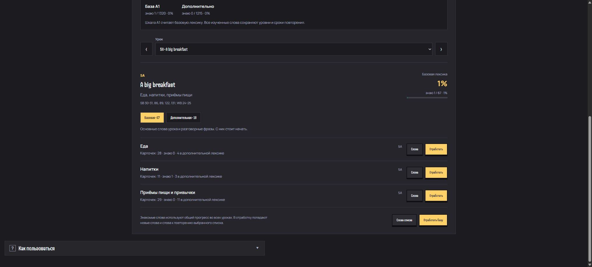
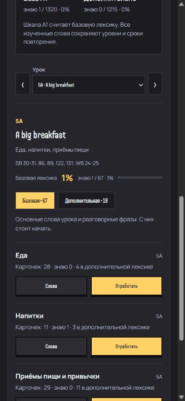
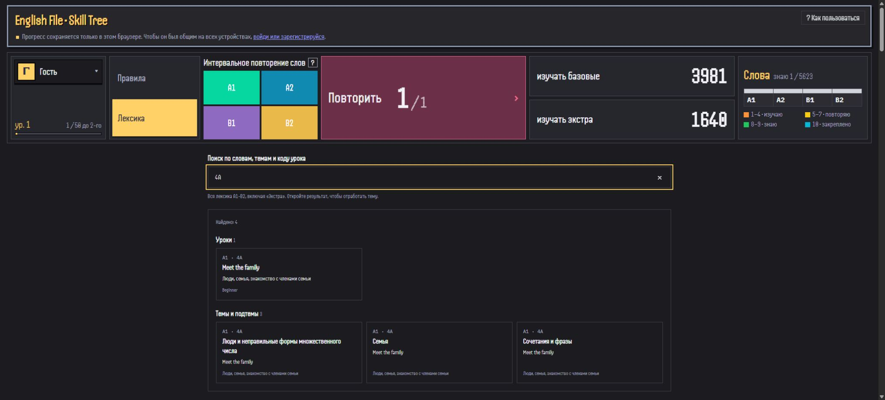
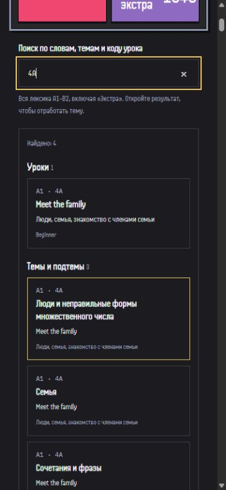
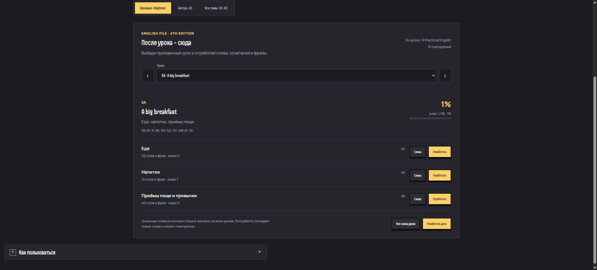
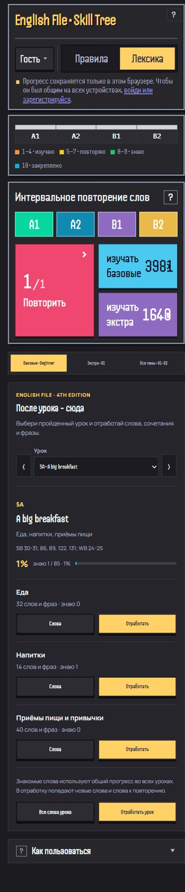

# Beginner: урок -> лексика -> отработка

Вкладка «По урокам · Beginner» следует English File Fourth Edition Beginner Student's Book и Workbook. Здесь 24 урока, 6 Practical English, 6 Revise and Check и 5 справочных разделов. 110 подтем содержат 2526 записей, включая повторения и алфавит.

На карточках тем и подтем указаны коды уроков (1A, 5A, PE 1) отдельной подписью, как в правилах.

В каждом уроке отдельно доступны списки «Базовая» и «Дополнительная». Можно открыть или отработать выбранный список целиком либо одну подтему. Сессия включает новые слова и слова, у которых подошёл срок повторения. Знакомое слово использует общий прогресс в разных уроках.

A1 содержит 1320 базовых карточек вместо прежних 2189. В дополнительных - 1215: 869 перенесённых карточек из материалов учебника и 346 прежних Extra. Число всех карточек A1 осталось 2535, всех уровней - 5623. Extra A1 доступна сразу; правила доступа Extra на A2-B2 прежние. Полное дерево доступно во вкладке «Все темы · A1-B2».

## Принцип отбора базы

Это редакционный список для данного курса, а не универсальный норматив количества слов A1. В базе оставлены основные тематические наборы (семья, страны, еда, одежда, профессии, время), частые глаголы и служебные слова, полезные бытовые сочетания и разговорные фразы. Например: `family`, `have breakfast`, `How was your day?`, `Enjoy your stay.`

В дополнительные перенесены сопутствующие слова из чтения, описаний и инструкций (`pyramids`, `psychic`, `iceberg`, `word stress`), длинные примеры из упражнений, большинство однотипных вариантов чисел и предложений. Алфавит сохраняется в уроке PE 1 как дополнительный набор, отдельные буквы не увеличивают обязательный словарный запас. В справочниках остаются оба списка: уже базовое слово не становится новым дополнительным словом только из-за повторения в инструкции.

Шкала A1 вверху, подпись уровня в дереве, мобильные счётчики и прогресс урока считают базовую лексику. Дополнительная имеет собственный счётчик. Общий счётчик «Все слова», уровень героя и очередь повторения учитывают изученные слова обеих частей.

## Покрытие учебника

| Раздел | Урок | Подтемы | Источник |
| --- | --- | --- | --- |
| 1A | A cappuccino, please | Знакомство и вежливые фразы; Числа от 0 до 10; Дни недели и прощание | SB 6-7, 116, 131; WB 4-5 |
| 1B | World music | Страны и география; Фразы | SB 8-9, 78, 82, 117, 131; WB 6-7 |
| PE 1 | How do you spell it | Алфавит и личные данные; Алфавит; Предметы в классе; Фразы на занятии; Заселение в отель; Бронирование столика | SB 10-11, 78, 82, 88, 118; WB 8-9 |
| 2A | Are you on holiday | Национальности и языки; Отпуск и общение | SB 12-13, 78, 82, 117, 131; WB 10-11 |
| 2B | That's my bus | Числа от 11 до 20; Десятки и составные числа; Личная информация и анкета; Вопросы и фразы; Помещения и расположение | SB 14-15, 79, 83, 86, 116, 131; WB 12-13 |
| Повторение 1-2 | Revise and Check 1 and 2 | Дополнительная лексика из повторения | SB 16-17 |
| 3A | Where are my keys | Вещи; Сочетания и фразы | SB 18-19, 81, 88, 119, 131; WB 14-15 |
| 3B | Souvenirs | Сувениры; Фразы при покупке | SB 20-21, 79, 83, 88, 131; WB 16-17 |
| PE 2 | Can I have an orange juice please | Деньги и покупки; Еда и напитки в меню; Заказ и оплата | SB 22-23, 88; WB 18-19 |
| 4A | Meet the family | Люди и неправильные формы множественного числа; Семья; Сочетания и фразы | SB 24-25, 86, 89, 120, 131; WB 20-21 |
| 4B | The perfect car | Цвета; Основные прилагательные; Машины и описание | SB 26-27, 89, 121, 131; WB 22-23 |
| Повторение 3-4 | Revise and Check 3 and 4 | Внешность и описание людей | SB 28-29 |
| 5A | A big breakfast | Еда; Напитки; Приёмы пищи и привычки | SB 30-31, 86, 89, 122, 131; WB 24-25 |
| 5B | A very long flight | Основные глагольные сочетания; Слова; Перелёт и дорога | SB 32-33, 89, 123, 131; WB 26-27 |
| PE 3 | What time is it | Время; Самочувствие; Вечер вне дома и полезные фразы | SB 34-35, 79, 83, 89; WB 28-29 |
| 6A | A school reunion | Профессии и занятия; Места работы и учёбы; Рабочие обязанности и общение | SB 36-37, 124, 131; WB 30-31 |
| 6B | Good morning, goodnight | Распорядок дня; Частотность и время; Из видео об обычном дне | SB 38-39, 89, 125, 131; WB 32-33 |
| Повторение 5-6 | Revise and Check 5 and 6 | Питание и полезные привычки | SB 40-41 |
| 7A | Have a nice weekend | Занятия в свободное время; Слова и фразы | SB 42-43, 89, 126, 132; WB 34-35 |
| 7B | Lights camera action | Виды фильмов; Кино и люди; Действия и фразы | SB 44-45, 90, 132; WB 36-37 |
| PE 4 | What's the date? | Месяцы; Порядковые числительные от 1 до 31; Даты и праздники; Телефонный разговор; Другие слова в заданиях этого раздела | SB 46-47, 90, 127; WB 38-39 |
| 8A | Can I park here | Вождение и экзамен; Действия и разрешения | SB 48-49, 80, 84, 90, 132; WB 40-41 |
| 8B | I love cooking | Виды занятий; Предпочтения и чувства; Пение в хоре | SB 50-51, 128, 132; WB 42-43 |
| Повторение 7-8 | Revise and Check 7 and 8 | Достопримечательности, рынок, спорт | SB 52-53 |
| 9A | Everything's fine | Путешествия и действия; Слова; Фразы | SB 54-55, 80, 84, 90, 126, 132; WB 44-45 |
| 9B | Working undercover | Одежда; Работа и обязанности | SB 56-57, 85, 90-91, 129, 132; WB 46-47 |
| PE 5 | Would you like to come | Места и события; Приглашение и ответ; Предложение еды и напитков; Другие полезные фразы; Фразы в письме | SB 58-59, 87, 91; WB 48-49 |
| 10A | A room with a view | В гостиничном номере; В отеле; Расположение и вопросы; Путешествия и природа | SB 60-61, 80, 84, 91, 130, 132; WB 50-51 |
| 10B | Where were you | Места и предлоги; Время в прошлом; Расследование и здания | SB 62-63, 91, 132; WB 52-53 |
| Повторение 9-10 | Revise and Check 9 and 10 | Поездка на выходные | SB 64-65 |
| 11A | A new life in the USA | Основные глаголы урока; Жизнь за границей | SB 66-67, 91, 132-133; WB 54-55 |
| 11B | How was your day | Сочетания с get; Сочетания с go; Сочетания с have; Сочетания с do; Другие слова и сочетания; Фразы и порядок событий | SB 68-69, 81, 87, 132-133; WB 56-57 |
| PE 6 | Is there a bank near here? | Места в городе; Расположение; Направления и действия | SB 70-71, 81, 85, 91; WB 58-59 |
| 12A | Strangers on a train | Ключевые глаголы и формы прошедшего времени; Поездка и знакомство; Сочетания и фразы | SB 72-73, 132-133; WB 60-61 |
| 12B | Revise the past | Повторяемые сочетания; Временные выражения и вопросы | SB 74-75; WB 62-63 |
| Повторение 11-12 | Revise and Check 11 and 12 | Учёба в другой стране и впечатления | SB 76-77 |
| Справочник 1 | Приложение 1 | Местоимения; Вопросительные слова и сочетания; Короткие слова и связки; Частые формы глаголов и сокращения | Справочник |
| Справочник 2 | Приложение 2 | Начальная форма / Past Simple - значение; Другие правильные глаголы из материалов и их формы Past Simple | Справочник |
| Справочник 3 | Приложение 3 | Начальная форма / Past Simple - значение; Другие неправильные глаголы из материалов без перечисления дополнительных форм | Справочник |
| Справочник 4 | Приложение 4 | Дополнительные слова из Sound Bank и упражнений на произношение | SB 134-135 и задания Pronunciation |
| Справочник 5 | Приложение 5 | Язык заданий, чтения и письма | Справочник |

## Поддержка данных

- `data-beginner-course.js` хранит порядок уроков, источники и лексику каждой подтемы.
- `beginner-curriculum.js` выполняется после прежних исправлений и дедупликации. Он формирует A1 базу и ссылки разделов на уникальные записи. Старые документы прогресса продолжают загружаться через `WORD_LEGACY_TOPICS`; `WORD_PROGRESS_ALIASES` сохраняет уровни, даты, интервалы и явные обнуления. Читается запись с самой свежей датой изменения.
- Старые карточки с оставшейся лексикой A1 сохраняют идентификаторы в Extra. Совпавшие слова из A2-B2 переносятся в A1 с тем же механизмом сохранения прогресса.
- Слова в разных значениях и с разными частями речи сопоставляются с учётом русского значения. Алфавит отделён от местоимений и артиклей. Формы вроде `child / children` и списки Past Simple ссылаются на общую запись.
- `beginner-course.js` и `beginner-course.css` отвечают за выбор урока и подтем.
- `data-beginner-core.js` хранит явный отбор исходных записей по урокам и подтемам. Это список с точным совпадением названий, без автоматического отбора по длине или части речи.
- `beginner-core.js` разделяет уже построенную лексику на базу и Extra. Базовые и полностью дополнительные темы сохраняют прежние ключи. При разделении смешанной темы дополнительные записи получают суффикс `-extra` и ссылки на прежний ключ курса и все старые ключи. Сохраняются полные SRS-записи, последнее изменение, явные обнуления и варианты ответа. Ссылки всех 110 подтем обновляются, слова не удаляются и не дублируются.

## Проверки

В «Лексике» и «Правилах» есть поисковая строка. Лексика ищется во всех A1-B2, включая Extra, по английскому слову, русскому переводу, названию темы и коду урока (`4A`, `PE 1`, `R1`, `APP1`). Запросы можно сочетать: `4A family`, `семья A1`. Коды сравниваются целиком: `1A` не включает `11A`. У правил учитываются диапазоны кодов с существующими буквами уроков этого уровня.

`catalog-search.js` строит общий индекс из действующих данных и ссылок курса. Формы и переводы из каждого урока ведут к общей записи прогресса. Из выдачи открываются урок, подтема, правило или список с подсвеченным словом. Поиск работает локально и не изменяет прогресс. Длинная выдача раскрывается кнопкой «Показать ещё»; Enter открывает первый результат, Escape очищает строку.

`npm run test:unit` - регрессионные проверки данных, сохранения прогресса, очередей отработки и вариантов ответов. `npm run test:access` - прежние проверки прав доступа через Firestore Emulator.

В браузере проверены выбор урока, переключение каталогов, запуск отработки подтемы, правильный ответ «Я знаю» и уровень 8, сохранение после перезагрузки, ручная смена уровня и мобильный вид 390 x 844.

Для поиска проверены `4A`, `4A family`, «семья», слово из Extra, открытие правила из диапазона `5A–6A` по `5B A1`, пустая выдача, очистка, Enter и дополнительные результаты. Всего 43 локальные проверки, включая полноту индекса, формы слов, переводы, точные коды, разделение базы/Extra, сохранение прежних ключей и полных записей прогресса, независимые очереди и поиск перенесённого слова.

В браузере дополнительно проверены два списка урока, раздел без обязательных слов, ручной уровень 8 для `barista` в Extra, неизменность прогресса базы при этом, сохранение после перезагрузки, поиск и подсветка перенесённого слова. Мобильный вид проверен при 390 x 844.

